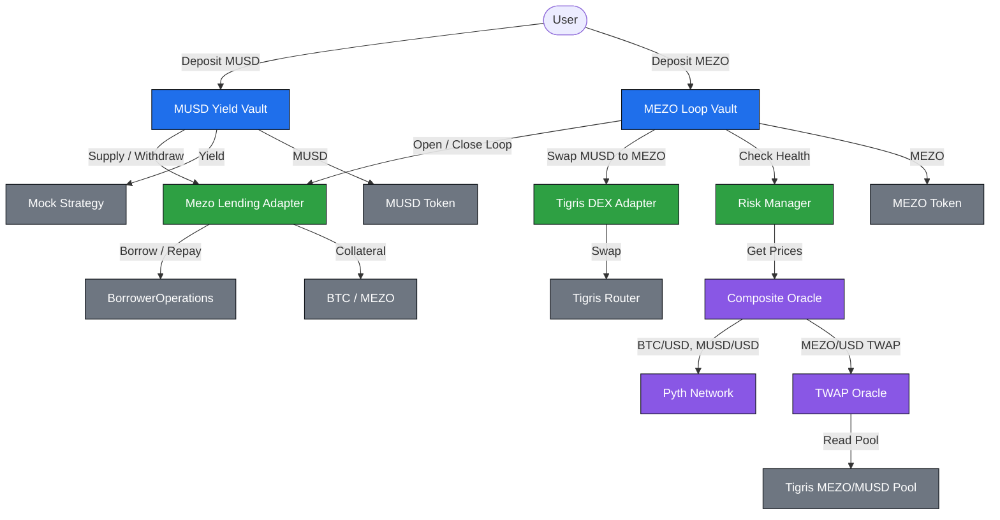

# MezoLoop

**Automated looping & yield vault for MUSD/MEZO on Mezo.**

[](https://mezo.org)
[](https://explorer.test.mezo.org)
[](#-testing)
[](./LICENSE)

MezoLoop is a DeFi strategy vault built for the **Mezo Buildathon, Track 1**. It integrates **MUSD** and **MEZO** to let users earn automated yield on MUSD and loop their MEZO positions with MUSD borrowing — all with built-in risk management and oracle safety.

---

## 💡 Why MezoLoop?

Bitcoin holders on Mezo face two problems:

1. **MUSD sits idle.** You borrow it against your BTC, but there's no built-in way to put it to work. It sits in your wallet earning nothing.
2. **MEZO holders want leverage, but looping is painful.** Manually looping (deposit → borrow → swap → redeposit → monitor health factor) is slow, gas-heavy, and risky — one bad oracle print and you're liquidated.

MezoLoop solves both:

- **MUSD Yield Vault** turns idle MUSD into auto-compounded yield.
- **MEZO Loop Vault** does the looping in one transaction — with auto-deleverage protection if the health factor drops.

Both are built on a **composite oracle** that prioritizes Pyth for BTC/MUSD and uses a TWAP fallback for MEZO, with conservative pricing and deviation guards on every read.

---

## ⚡ Judge's 30-Second Checklist

1. **Live frontend:** [`mezoloop.vercel.app`](#) *(update after deploy)*
2. **Demo video:** [2-minute walkthrough](#) *(update after recording)*
3. **Verify on-chain:** [CompositeOracle on explorer](https://explorer.test.mezo.org/address/0x...) *(update with address)*
4. **Run tests:** `forge test -vvv` → **32 passing**
5. **Proof of live oracle:**

   ```bash
   cast call <ORACLE_ADDRESS> "getPrice(address)(uint256)" 0x118917a40FAF1CD7a13dB0Ef56C86De7973Ac503 \
     --rpc-url https://rpc.test.mezo.org
   # → 1000000000000000000  ($1.00 MUSD)
   ```

---

## 🎥 Demo

[](#)

A 2–3 minute walkthrough covering: wallet connect on Mezo Testnet, MUSD deposit into the yield vault, MEZO loop open → close cycle, and the live health-factor display driven by `CompositeOracle`.

*(Video link added before Wave 1 submission.)*

---

## 🚀 Features

- **MUSD Yield Vault** — Deposit MUSD, earn auto-compounded yield via a pluggable strategy.
- **MEZO Loop Vault** — Deposit MEZO, borrow MUSD, swap, and redeposit to achieve up to 2× leveraged yield in a single transaction.
- **Auto-Deleverage** — Health-factor monitoring automatically reduces leverage when liquidation risk rises.
- **Composite Oracle** — Pyth primary for BTC and MUSD, TWAP fallback for MEZO, with staleness checks, 5% deviation guard, and conservative pricing.
- **Risk Manager** — Centralized risk checks block unsafe borrows during price volatility.
- **Testnet Ready** — Deployed and verified on Mezo Testnet.

---

## 🧠 Architecture



### Component Overview

| Component | Role |
|-----------|------|
| **MUSD Yield Vault** | ERC-4626 vault for MUSD deposits. Auto-compounds yield via a pluggable strategy. |
| **MEZO Loop Vault** | Accepts MEZO, borrows MUSD, swaps, and redeposits to create leveraged yield. Includes auto-deleverage. |
| **Risk Manager** | Centralised health-factor checks. Blocks unsafe borrows during price deviations. Triggers auto-deleverage. |
| **Composite Oracle** | Aggregates Pyth (BTC, MUSD) and a TWAP (MEZO) with staleness checks and conservative pricing. |
| **Pyth Network** | Official price feeds for BTC/USD on Mezo Testnet. |
| **TWAP Oracle** | Time-weighted average price for MEZO derived from the Tigris MEZO/MUSD pool *(mainnet only — see limitations)*. |
| **Mezo Lending Adapter** | Abstracts Mezo's `BorrowerOperations` for depositing collateral and borrowing/repaying MUSD. |
| **Tigris DEX Adapter** | Wraps Tigris Router for MUSD ⇄ MEZO swaps with slippage protection. |
| **BorrowerOperations** | Mezo's native lending contract (Liquity-style trove system). |
| **Tigris Router** | Mezo's native DEX router for token swaps. |

---

## 📡 Oracle Design

MezoLoop uses a **composite oracle** to safely price assets:

- **BTC/USD** → Pyth Network (primary), `MockTwap` $60,000 (testnet fallback)
- **MUSD/USD** → Pyth Network (primary), $1.00 peg (fallback — no MUSD/USD feed on testnet)
- **MEZO/USD** → `MockTwap` $0.50 on testnet · **real TWAP from the Tigris MEZO/MUSD pool on Mezo Mainnet (Wave 2)**

**Safety features:**

- **Staleness checks** — Pyth prices must be fresher than 60 seconds; TWAP observations must be fresher than 30 minutes.
- **Deviation guard** — If the spot price deviates more than 5% from the TWAP, the oracle returns a conservative price (lower for collateral, higher for debt).
- **Fallback hierarchy** — If Pyth is stale, the system falls back to TWAP where applicable. If both fail, the read reverts — it never returns an unsafe price silently.
- **Directional conservatism** — `PriceType.Collateral` returns the lower of spot/TWAP; `PriceType.Debt` returns the higher. Vaults cannot game the guard by choosing the favourable direction.

> ⚠️ **Testnet Disclaimer:** There is **no MEZO/MUSD liquidity pool on Mezo Testnet**. The MEZO price on testnet is served by a `MockTwap` at a fixed $0.50 placeholder. The `TwapOracleAdapter` and `MezoTwapOracle` contracts are implemented and unit-tested but cannot be wired on testnet because the underlying pool only exists on Mezo Mainnet at [`0x1d6e8d24c133535f2d00676f66a0e824f84765ff`](https://explorer.mezo.org/address/0x1d6e8d24c133535f2d00676f66a0e824f84765ff) (~$25k liquidity, Uniswap-V2-style cumulative prices). Wave 2 redeploys on mainnet with the real TWAP.

---

## ✅ Wave 1 Deliverables

- [x] `CompositeOracle` — Pyth + TWAP + deviation guard (23 tests passing)
- [x] `TwapOracleAdapter` — UQ112x112 decoder, staleness checks (4 tests passing)
- [x] `MezoTwapOracle` — MEZO/USD wrapper (5 tests passing)
- [ ] `MUSDYieldVault` — ERC-4626 with pluggable strategy
- [ ] `MEZOLoopVault` — open/close loop + auto-deleverage
- [ ] `RiskManager` — health factor + deviation guard, integrated with vaults
- [ ] Deploy full stack to Mezo Testnet
- [ ] Frontend deployed to Vercel
- [ ] Demo video (2 min)
- [ ] Live MEZO price on testnet *(not possible — Wave 2, mainnet only)*

*(Update checkboxes as you ship. Judges compare claims against the repo.)*

---

## 📍 Deployed Contracts (Mezo Testnet · Chain ID 31611)

### MezoLoop Contracts

| Contract | Address |
|----------|---------|
| CompositeOracle | [`0x...`](https://explorer.test.mezo.org/address/0x...) |
| MockTwap (BTC) | [`0x...`](https://explorer.test.mezo.org/address/0x...) |
| MockTwap (MEZO) | [`0x...`](https://explorer.test.mezo.org/address/0x...) |
| MUSDYieldVault | `0x...` *(pending)* |
| MEZOLoopVault | `0x...` *(pending)* |
| RiskManager | `0x...` *(pending)* |

### Mezo Protocol Addresses (Testnet)

| Contract | Address |
|----------|---------|
| Pyth Oracle | [`0x2880aB155794e7179c9eE2e38200202908C17B43`](https://explorer.test.mezo.org/address/0x2880aB155794e7179c9eE2e38200202908C17B43) |
| MUSD Token | [`0x118917a40FAF1CD7a13dB0Ef56C86De7973Ac503`](https://explorer.test.mezo.org/address/0x118917a40FAF1CD7a13dB0Ef56C86De7973Ac503) |
| Tigris Router | `0x9a1ff7FE3a0F69959A3fBa1F1e5ee18e1A9CD7E9` |
| Tigris PoolFactory | `0x4947243CC818b627A5D06d14C4eCe7398A23Ce1A` |
| BTC/USD Pyth Feed ID | `0xe62df6c8b4a85fe1a67db44dc12de5db330f7ac66b72dc658afedf0f4a415b43` |

### MEZO/MUSD Pool (Mezo Mainnet — Wave 2)

| Item | Value |
|------|-------|
| Pool address | [`0x1d6e8d24c133535f2d00676f66a0e824f84765ff`](https://explorer.mezo.org/address/0x1d6e8d24c133535f2d00676f66a0e824f84765ff) |
| Network | Mezo Mainnet (Chain ID 31612) |
| Interface | Uniswap V2-style (`price0CumulativeLast()`) |
| Liquidity | ~$25,000 |

---

## 🛠 Tech Stack

- **Smart Contracts:** Solidity ^0.8.20, Foundry, OpenZeppelin
- **Oracles:** Pyth Network, custom Uniswap-V2-style TWAP
- **DEX:** Tigris (Mezo Pools)
- **Frontend:** Next.js, wagmi, viem, RainbowKit *(in progress)*
- **Network:** Mezo Testnet (Chain ID 31611)

---

## 🚦 Getting Started

### Prerequisites

- [Foundry](https://book.getfoundry.sh/getting-started/installation)
- Node.js 20+ (for frontend)
- Mezo Testnet added to your wallet

### Installation

```bash
git clone https://github.com/syed-ghufran-hassan/mezoloop.git
cd mezoloop

forge install OpenZeppelin/openzeppelin-contracts
forge install foundry-rs/forge-std
```

### Environment Setup

Create a `.env` file:

```bash
PRIVATE_KEY=your_wallet_private_key
MEZO_RPC=https://rpc.test.mezo.org
```

Load it:

```bash
source .env
```

### Build

```bash
forge build
```

### Test

```bash
forge test -vvv
```

### Deploy

```bash
forge script script/DeployOracle.s.sol:DeployOracle \
  --rpc-url $MEZO_RPC \
  --private-key $PRIVATE_KEY \
  --broadcast --legacy
```

### Verify

```bash
forge verify-contract <DEPLOYED_ADDRESS> \
  src/CompositeOracle.sol:CompositeOracle \
  --chain-id 31611 \
  --verifier-url https://explorer.test.mezo.org/api
```

---

## 🧪 Testing

```bash
forge test -vvv
```

**Expected: 32 tests passing** across:

| Suite | Count | Coverage |
|-------|-------|----------|
| `CompositeOracleTest` | 23 | Pyth freshness, TWAP fallback, deviation guard (incl. boundary), MUSD peg fallback, admin controls, unsupported asset |
| `TwapOracleAdapterTest` | 4 | UQ112x112 decoding, observation staleness, zero-elapsed revert, permissionless `update()` |
| `MezoTwapOracleTest` | 5 | MEZO/USD derivation, MUSD peg fallback, stale MUSD revert, stale TWAP revert, invalid MUSD price revert |

---

## 🌐 Testnet Resources

- **Mezo Testnet Faucet:** https://faucet.test.mezo.org/
- **Mezo Testnet dApp:** https://testnet.mezo.org
- **Block Explorer:** https://explorer.test.mezo.org/
- **Mezo Discord:** https://discord.mezo.org

---

## 🗺 Roadmap

### Wave 1 — Current

- [x] Composite Oracle with Pyth + TWAP fallback
- [x] `TwapOracleAdapter` + `MezoTwapOracle`
- [ ] `MUSDYieldVault` with auto-compounding strategy
- [ ] `MEZOLoopVault` with auto-deleverage
- [ ] `RiskManager` integrated with both vaults
- [ ] Full stack deployed to Mezo Testnet
- [ ] Frontend UI deployed to Vercel
- [ ] Demo video

### Wave 2 — Planned

- [ ] Deploy on **Mezo Mainnet** with real Tigris MEZO/MUSD TWAP
- [ ] Integrate real Mezo `BorrowerOperations` for lending
- [ ] Wire real Tigris Router for MUSD ⇄ MEZO swaps
- [ ] Cross-chain expansion (Ethereum, Base, BNB Chain)
- [ ] Staking derivatives for MEZO
- [ ] Strategy marketplace and vault aggregator
- [ ] Telegram alerts for liquidation risk
- [ ] Smart contract audit

---

## ⚠️ Known Limitations & Security

| Limitation | Impact | Wave 2 Plan |
|-----------|--------|-------------|
| MEZO price is mocked on testnet | Testnet only — no real MEZO/MUSD pool exists on Mezo Testnet | Redeploy on Mezo Mainnet with real Tigris pool `0x1d6e...65ff` |
| BTC price on testnet uses `MockTwap` | Testnet only — BTC is native, no ERC20 pool to read | BTC Pyth feed is live on mainnet; real TWAP wired in Wave 2 |
| Lending adapter uses a mock in Wave 1 | No real Mezo `BorrowerOperations` integration | Full `BorrowerOperations` integration in Wave 2 |
| DEX adapter uses a 1:1 mock swap in Wave 1 | No real slippage modelling | Wire Tigris Router in Wave 2 |
| No external audit | Not safe for real funds | Audit before mainnet launch |

> 🚨 **Not audited. Not for production use. Testnet deployment only.**

---

## 🎯 Track 1 Alignment

This project directly addresses the **DeFi (Borrowing, Lending, Looping, and Yield)** track by:

- **Expanding MUSD & MEZO utility** as collateral and productive capital.
- **Building composable vaults** that plug into lending markets and DEXs.
- **Extending Mezo's core products** (borrowing, yield) rather than building an unrelated app.
- **Demonstrating long-term commitment** with a clear Wave 2 roadmap extending to mainnet, cross-chain deployment, and strategy composability.

---

## 👤 Team

Built by **Syed Ghufran Hassan** ([@syed-ghufran-hassan](https://github.com/syed-ghufran-hassan)) for the Mezo Buildathon Track 1.

Questions? Reach out on [Mezo Discord](https://discord.mezo.org).

---

## 📄 License

This project is licensed under the MIT License. See the [LICENSE](./LICENSE) file for details.

---

**Built with ❤️ for the Mezo ecosystem.**